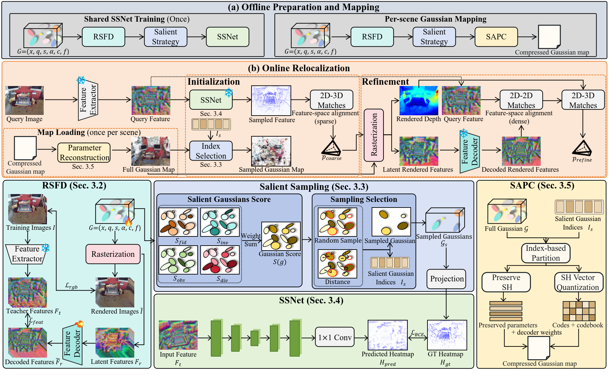
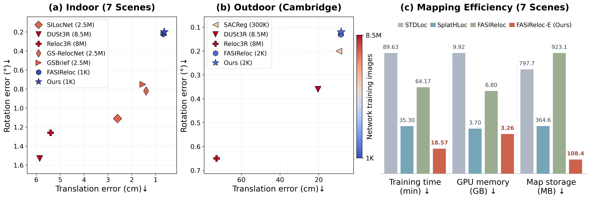

# FASIReloc-E: Localization-Aware Compact Feature Gaussian Maps for Transferable Camera Relocalization

## Overiew




## Abstract

Feature Gaussian maps support accurate camera relocalization, but their high-dimensional descriptors and appearance attributes introduce substantial optimization and storage costs. Moreover, conventional Gaussian compression does not consider the different roles of Gaussian primitives in sparse initialization and dense refinement. We present FASIReloc-E, an efficient camera relocalization framework that combines compact feature representations with localization-aware attribute coding.
Building on our previous FASIReloc framework, salient Gaussian anchors and a transferable saliency predictor provide reliable 2D-3D correspondences for initial pose estimation, while the complete Gaussian scene supports dense refinement. To reduce feature-related costs, Render-Space Feature Distillation (RSFD) adapts existing render-then-decode learning to camera relocalization by learning compact Gaussian descriptors under supervision from a fixed teacher feature extractor. The rendered features are decoded into the teacher descriptor space for correspondence estimation.
Salient-Anchor-Preserved Coding (SAPC) further reduces map storage by retaining compact descriptors for all Gaussians, preserving the spherical harmonic (SH) coefficients of salient anchors, and vector-quantizing those of non-salient Gaussians. All Gaussian primitives are retained for dense rendering and pose refinement.The saliency predictor transfers to unseen scenes without fine-tuning, while Gaussian maps and feature decoders are optimized separately for each target scene.
Experiments on four public benchmarks demonstrate competitive localization accuracy together with substantial reductions in Gaussian optimization and storage costs.


## Comparison




## Environment Setup and Installation

Our experiments were conducted on **Ubuntu 22.04** with **CUDA 12.1** and **Python 3.8**. While the codebase is expected to be compatible with similar configurations, it has not been extensively tested beyond the reported setup.

```bash
# 1. Create a Conda environment with Python 3.8
conda create -n fasireloc-e python=3.8 -y
conda activate fasireloc-e

# 2. Install PyTorch with CUDA 12.1 support
python -m pip install torch==2.4.1 torchvision==0.19.1 torchaudio==2.4.1 \
  --index-url https://download.pytorch.org/whl/cu121

# 3. Install the required Python dependencies
python -m pip install -r requirements.txt

# 4. Install Mamba-SSM
python -m pip install mamba-ssm==2.2.2 --no-build-isolation

# 5. Install gsplat from the specified Git commit
python -m pip install --no-build-isolation \
  "git+https://github.com/nerfstudio-project/gsplat.git@4d3a3b69db4de0326f983ccf7b7b255271a17b01"

# 6. Install the simple-knn CUDA extension
git clone --recursive https://github.com/graphdeco-inria/gaussian-splatting.git ../gaussian-splatting

python -m pip install --no-build-isolation \
  ../gaussian-splatting/submodules/simple-knn
```


## Dataset

**Data structure**

We use six public datasets：

- [Scannet](https://github.com/ScanNet/ScanNet)
- [MegaDepth](https://www.cs.cornell.edu/projects/megadepth/)
- [Microsoft 7-Scenes](https://www.microsoft.com/en-us/research/project/rgb-d-dataset-7-scenes/)
- [Cambridge Landmarks](https://www.repository.cam.ac.uk/handle/1810/251342/)
- [12 Scenes](https://graphics.stanford.edu/projects/reloc/)
- [MARS](https://ai4ce.github.io/MARS/)

All datasets are organized under the `datasets/` directory of the project page, following a unified directory structure:

```bash
datasets/
├── 7scenes/
│   ├── chess/
│   └── fire/
│   └── .../
├── cambridge/
│   ├── GreatCourt/
│   └── ...
└── ...
```

**Scannet、MegaDepth**

1. Download datasets following their official link.

**7 Scenes**

1. Download images following [HLoc](https://github.com/cvg/Hierarchical-Localization).

   ```bash
   export dataset=datasets/7scenes
   for scene in chess fire heads office pumpkin redkitchen stairs; \
   do wget http://download.microsoft.com/download/2/8/5/28564B23-0828-408F-8631-23B1EFF1DAC8/$scene.zip -P $dataset \
   && unzip $dataset/$scene.zip -d $dataset && unzip $dataset/$scene/'*.zip' -d $dataset/$scene; done
   ```

2. Download full reconstructions from [visloc_pseudo_gt_limitations](https://github.com/tsattler/visloc_pseudo_gt_limitations/tree/main?tab=readme-ov-file#full-reconstructions):

   ```bash
   pip install gdown
   gdown 1ATijcGCgK84NKB4Mho4_T-P7x8LSL80m -O $dataset/7scenes_reference_models.zip
   unzip $dataset/7scenes_reference_models.zip -d $dataset
   # move sfm_gt to each dataset
   for scene in chess fire heads office pumpkin redkitchen stairs; \
   do mkdir -p $dataset/$scene/sparse && cp -r $dataset/7scenes_reference_models/$scene/sfm_gt $dataset/$scene/sparse/0 ; done
   ```

**Cambridge**

1. Download images from [PoseNet](https://www.repository.cam.ac.uk/items/53788265-cb98-42ee-b85b-7a0cbc8eddb3)'s project page:

   ```bash
   export dataset=datasets/cambridge
   export scenes=( "KingsCollege" "OldHospital" "StMarysChurch" "ShopFacade" "GreatCourt" )
   export IDs=( "251342" "251340" "251294" "251336" "251291" )
   for i in "${!scenes[@]}"; do
   wget https://www.repository.cam.ac.uk/bitstream/handle/1810/${IDs[i]}/${scenes[i]}.zip -P $dataset \
   && unzip $dataset/${scenes[i]}.zip -d $dataset ; done
   ```

2. Install Mask2Former:

   ```bash
   cd submodules/Mask2Former
   pip install -r requirements.txt
   python -m pip install 'git+https://github.com/facebookresearch/detectron2.git'
   cd mask2former/modeling/pixel_decoder/ops
   sh make.sh
   cd ../../../..
   # download model
   wget https://dl.fbaipublicfiles.com/maskformer/mask2former/coco/panoptic/maskformer2_swin_large_IN21k_384_bs16_100ep/model_final_f07440.pkl
   cd ../..
   ```

3. Preprocess data:

   ```bash
   bash scripts/dataset_preprocess.sh
   ```

**12 Scenes**

1. Download images following [HLoc](https://github.com/cvg/Hierarchical-Localization).

   ```bash
   export dataset=datasets/12scenes
   for scene in apt1 apt2 office1 office2; \
   do wget https://graphics.stanford.edu/projects/reloc/data/$scene.zip -P $dataset \
   && unzip $dataset/$scene.zip -d $dataset && unzip $dataset/$scene/'*.zip' -d $dataset/$scene; done
   ```

2. Download full reconstructions from [visloc_pseudo_gt_limitations](https://github.com/tsattler/visloc_pseudo_gt_limitations/tree/main?tab=readme-ov-file#full-reconstructions):

   ```bash
   pip install gdown
   gdown 1u5du-cYp3J3-BfybZVkhvgv0PPua8tud -O $dataset/12scenes_reference_models.zip
   unzip $dataset/12scenes_reference_models.zip -d $dataset
   # move sfm_gt to each dataset
   for scene in apt1/kitchen apt1/living apt2/bed apt2/kitchen apt2/living apt2/luke office1/gates362 office1/gates381 office1/lounge office1/manolis office2/5a office2/5b; 
   do mkdir -p "$dataset/$scene/data/sparse" && cp -r $dataset/12scenes_reference_models/$scene/sfm_gt $dataset/$scene/sparse/0/ ;
   done
   ```

**MARS**

1. Download datasets and full reconstructions following [RAP](https://github.com/ai4ce/RAP).


## Evaluation

````bash

## Evaluation

Before evaluation, decompress the SAPC-compressed Gaussian maps and save the reconstructed `point_cloud.ply` files to their corresponding scene directories.
Each map only needs to be decompressed once.

### Step 1: Map Decompression

```bash
# 7 Scenes
bash scripts/decompress_7scenes.sh

# Cambridge Landmarks
bash scripts/decompress_cambridge.sh
```

### Step 2: Camera Relocalization

```bash
# Scene-dependent
bash scripts/evaluate_dependent_7scenes.sh
bash scripts/evaluate_dependent_cambridge.sh

# Scene-independent
bash scripts/evaluate_independent_7scenes.sh
bash scripts/evaluate_independent_cambridge.sh
```

````


## Code Availability

During the review process, this repository provides the map decompression, inference, and evaluation code for FASIReloc-E under both scene-dependent and scene-independent settings. The current release supports camera relocalization using SAPC-compressed Gaussian maps, which are reconstructed before evaluation. The code for Gaussian map training, feature distillation, and compression will be made publicly available upon acceptance of the paper.

