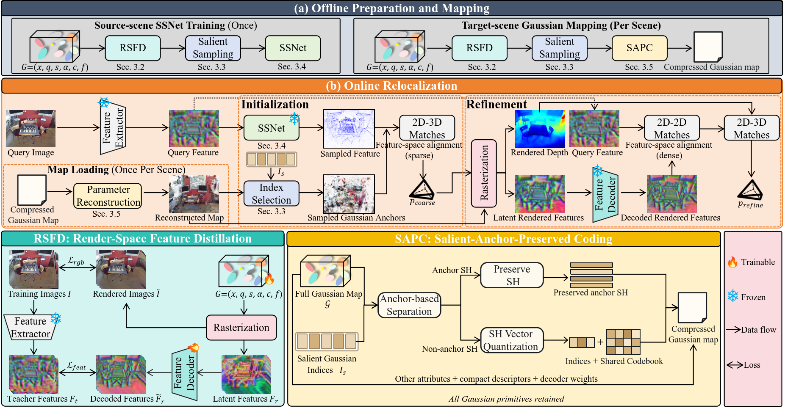
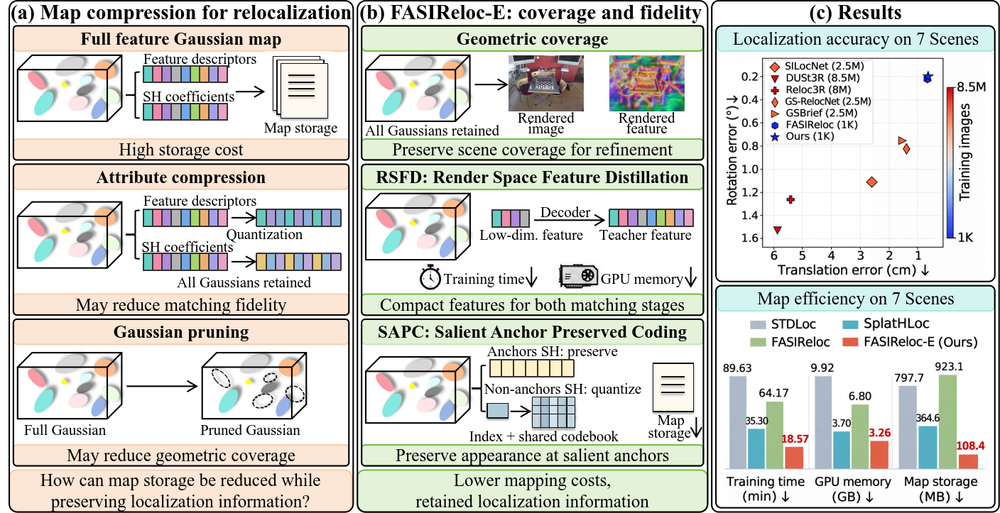

# FASIReloc-E: Localization-Aware Compact Feature Gaussian Maps for Transferable Camera Relocalization

## Overview




## Abstract

Reliable camera relocalization requires salient 3D landmarks for sparse pose initialization and sufficient scene coverage for dense refinement.
Feature Gaussian maps support both stages but incur substantial optimization and storage costs due to high-dimensional descriptors.
We present FASIReloc-E, an efficient relocalization framework that compresses Gaussian attributes according to their localization roles while retaining all Gaussian primitives.
Render-Space Feature Distillation (RSFD) learns compact descriptors under supervision from a frozen SuperPoint teacher and decodes them into a shared feature space for sparse landmark matching and dense rendered-feature matching.
Salient-Anchor-Preserved Coding (SAPC) extends the localization anchors introduced in FASIReloc to appearance preservation, retaining their spherical harmonic (SH) coefficients while vector-quantizing non-anchor SH coefficients.
Compact localization descriptors are preserved without further vector quantization.
A pretrained JamMa matcher supports dense correspondence refinement.
The SSNet saliency predictor transfers to unseen scenes without fine-tuning, whereas Gaussian maps and feature decoders are optimized separately for each target scene.
Experiments on four benchmarks demonstrate competitive localization accuracy with substantially improved representation efficiency.
Ablations reveal a favorable storage-accuracy trade-off and show that retaining non-anchor Gaussians with quantized SH yields higher pose recall than pruning at comparable map sizes.
On 7 Scenes, FASIReloc-E reduces Gaussian optimization time, peak training GPU memory, and map storage by 71.1%, 52.1%, and 88.3%, respectively, compared with FASIReloc, while improving full-system recall at (2 cm, 2°) from 93.47% to 95.23%.


## Motivation




## Environment Setup and Installation

Our experiments were conducted on **Ubuntu 22.04** with **CUDA 12.1** and **Python 3.8**. While the codebase is expected to be compatible with similar configurations, it has not been extensively tested beyond the reported setup.

```bash
# 1. Create a Conda environment with Python 3.8
conda create -n fasireloc-e python=3.8 -y
conda activate fasireloc-e

# 2. Install PyTorch with CUDA 12.1 support
python -m pip install torch==2.4.1 torchvision==0.19.1 torchaudio==2.4.1 \
  --index-url https://download.pytorch.org/whl/cu121

# 3. Install the required Python dependencies
python -m pip install -r requirements.txt

# 4. Install Mamba-SSM
python -m pip install mamba-ssm==2.2.2 --no-build-isolation

# 5. Install gsplat from the specified Git commit
python -m pip install --no-build-isolation \
  "git+https://github.com/nerfstudio-project/gsplat.git@4d3a3b69db4de0326f983ccf7b7b255271a17b01"

# 6. Install the simple-knn CUDA extension
git clone --recursive https://github.com/graphdeco-inria/gaussian-splatting.git ../gaussian-splatting

python -m pip install --no-build-isolation \
  ../gaussian-splatting/submodules/simple-knn
```


## Dataset

**Data Preparation**

We use six public datasets for training and evaluation.

**Source datasets for scene-independent SSNet training:**

- [ScanNet](https://github.com/ScanNet/ScanNet)
- [MegaDepth](https://www.cs.cornell.edu/projects/megadepth/)

**Benchmark datasets for camera relocalization:**

- [Microsoft 7-Scenes](https://www.microsoft.com/en-us/research/project/rgb-d-dataset-7-scenes/)
- [Cambridge Landmarks](https://www.repository.cam.ac.uk/handle/1810/251342/)
- [12 Scenes](https://graphics.stanford.edu/projects/reloc/)
- [MARS](https://ai4ce.github.io/MARS/)


**Data structure**

All datasets are organized under the `datasets/` directory of the project page, following a unified directory structure:

```bash
datasets/
├── 7scenes/
│   ├── chess/
│   └── fire/
│   └── .../
├── cambridge/
│   ├── GreatCourt/
│   └── ...
└── ...
```


**ScanNet、MegaDepth**

1. Download datasets following their official link.

**7 Scenes**

1. Download images following [HLoc](https://github.com/cvg/Hierarchical-Localization).

   ```bash
   export dataset=datasets/7scenes
   for scene in chess fire heads office pumpkin redkitchen stairs; \
   do wget http://download.microsoft.com/download/2/8/5/28564B23-0828-408F-8631-23B1EFF1DAC8/$scene.zip -P $dataset \
   && unzip $dataset/$scene.zip -d $dataset && unzip $dataset/$scene/'*.zip' -d $dataset/$scene; done
   ```

2. Download full reconstructions from [visloc_pseudo_gt_limitations](https://github.com/tsattler/visloc_pseudo_gt_limitations/tree/main?tab=readme-ov-file#full-reconstructions):

   ```bash
   pip install gdown
   gdown 1ATijcGCgK84NKB4Mho4_T-P7x8LSL80m -O $dataset/7scenes_reference_models.zip
   unzip $dataset/7scenes_reference_models.zip -d $dataset
   # move sfm_gt to each dataset
   for scene in chess fire heads office pumpkin redkitchen stairs; \
   do mkdir -p $dataset/$scene/sparse && cp -r $dataset/7scenes_reference_models/$scene/sfm_gt $dataset/$scene/sparse/0 ; done
   ```

**Cambridge**

1. Download images from [PoseNet](https://www.repository.cam.ac.uk/items/53788265-cb98-42ee-b85b-7a0cbc8eddb3)'s project page:

   ```bash
   export dataset=datasets/cambridge
   export scenes=( "KingsCollege" "OldHospital" "StMarysChurch" "ShopFacade" "GreatCourt" )
   export IDs=( "251342" "251340" "251294" "251336" "251291" )
   for i in "${!scenes[@]}"; do
   wget https://www.repository.cam.ac.uk/bitstream/handle/1810/${IDs[i]}/${scenes[i]}.zip -P $dataset \
   && unzip $dataset/${scenes[i]}.zip -d $dataset ; done
   ```

2. Install Mask2Former:

   ```bash
   cd submodules/Mask2Former
   pip install -r requirements.txt
   python -m pip install 'git+https://github.com/facebookresearch/detectron2.git'
   cd mask2former/modeling/pixel_decoder/ops
   sh make.sh
   cd ../../../..
   # download model
   wget https://dl.fbaipublicfiles.com/maskformer/mask2former/coco/panoptic/maskformer2_swin_large_IN21k_384_bs16_100ep/model_final_f07440.pkl
   cd ../..
   ```

3. Preprocess data:

   ```bash
   bash scripts/dataset_preprocess.sh
   ```

**12 Scenes**

1. Download images following [HLoc](https://github.com/cvg/Hierarchical-Localization).

   ```bash
   export dataset=datasets/12scenes
   for scene in apt1 apt2 office1 office2; \
   do wget https://graphics.stanford.edu/projects/reloc/data/$scene.zip -P $dataset \
   && unzip $dataset/$scene.zip -d $dataset && unzip $dataset/$scene/'*.zip' -d $dataset/$scene; done
   ```

2. Download full reconstructions from [visloc_pseudo_gt_limitations](https://github.com/tsattler/visloc_pseudo_gt_limitations/tree/main?tab=readme-ov-file#full-reconstructions):

   ```bash
   pip install gdown
   gdown 1u5du-cYp3J3-BfybZVkhvgv0PPua8tud -O $dataset/12scenes_reference_models.zip
   unzip $dataset/12scenes_reference_models.zip -d $dataset
   # move sfm_gt to each dataset
   for scene in apt1/kitchen apt1/living apt2/bed apt2/kitchen apt2/living apt2/luke office1/gates362 office1/gates381 office1/lounge office1/manolis office2/5a office2/5b; 
   do mkdir -p "$dataset/$scene/sparse" && cp -r $dataset/12scenes_reference_models/$scene/sfm_gt $dataset/$scene/sparse/0/ ;
   done
   ```

**MARS**

1. Download datasets and full reconstructions following [RAP](https://github.com/ai4ce/RAP).


## Training

````bash
## Training

### Step 1: Feature Gaussian Training

Train feature Gaussian maps and scene-dependent SSNet.

```bash
# 7 Scenes
bash scripts/train_dependent_7scenes.sh

# Cambridge Landmarks
bash scripts/train_dependent_cambridge.sh
```

### Step 2: Map Compression

Compress the trained Gaussian maps using SAPC.

```bash
# 7 Scenes
bash scripts/compress_7scenes.sh

# Cambridge Landmarks
bash scripts/compress_cambridge.sh
```


````


## Evaluation

````bash

## Evaluation

### Step 1: Map Decompression

Reconstruct the SAPC-compressed Gaussian maps before evaluation.
Each map only needs to be decompressed once.

```bash
# 7 Scenes
bash scripts/decompress_7scenes.sh

# Cambridge Landmarks
bash scripts/decompress_cambridge.sh
```

### Step 2: Camera Relocalization

**Scene-dependent**

```bash
bash scripts/evaluate_dependent_7scenes.sh
bash scripts/evaluate_dependent_cambridge.sh
```

**Scene-independent**

```bash
bash scripts/evaluate_independent_7scenes.sh
bash scripts/evaluate_independent_cambridge.sh
```

Scene-independent evaluation requires SSNet checkpoints trained on source scenes without fine-tuning on target scenes.

````


## Code Availability

During the review process, we provide Gaussian map training, feature distillation, compression, decompression, and evaluation code for 7 Scenes and Cambridge Landmarks under both localization settings. For scene-independent SSNet training, please refer to our conference version [FASIReloc](https://github.com/junhaowei0524/FASIReloc). The remaining materials will be made publicly available upon acceptance of the paper.
